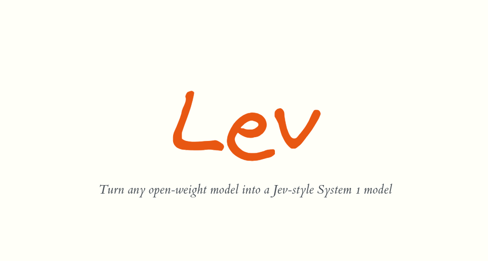
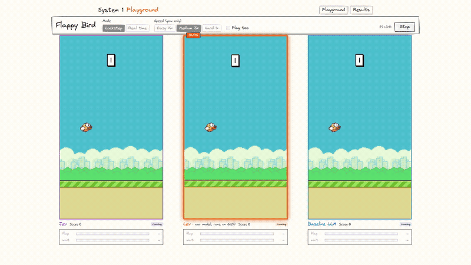
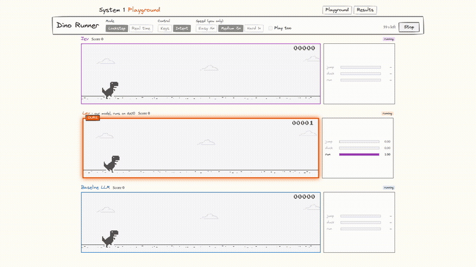
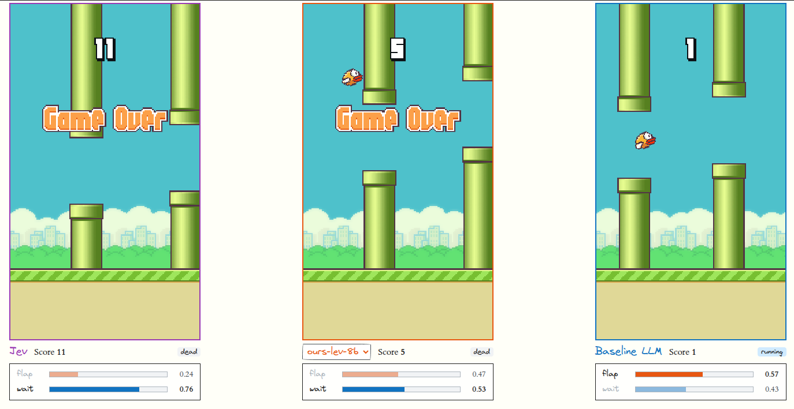
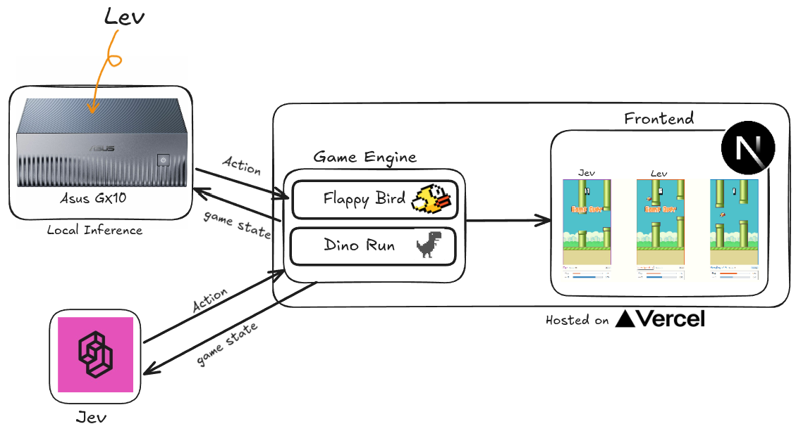
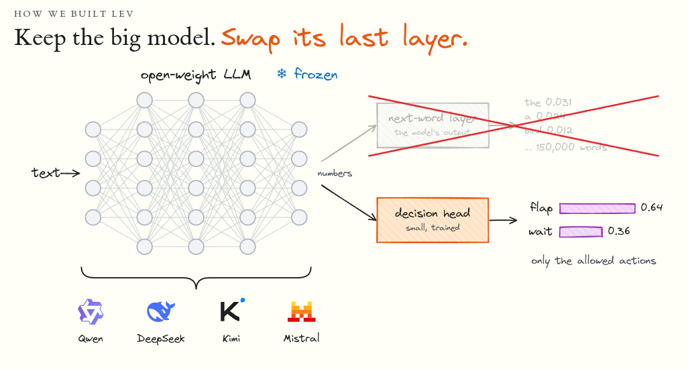
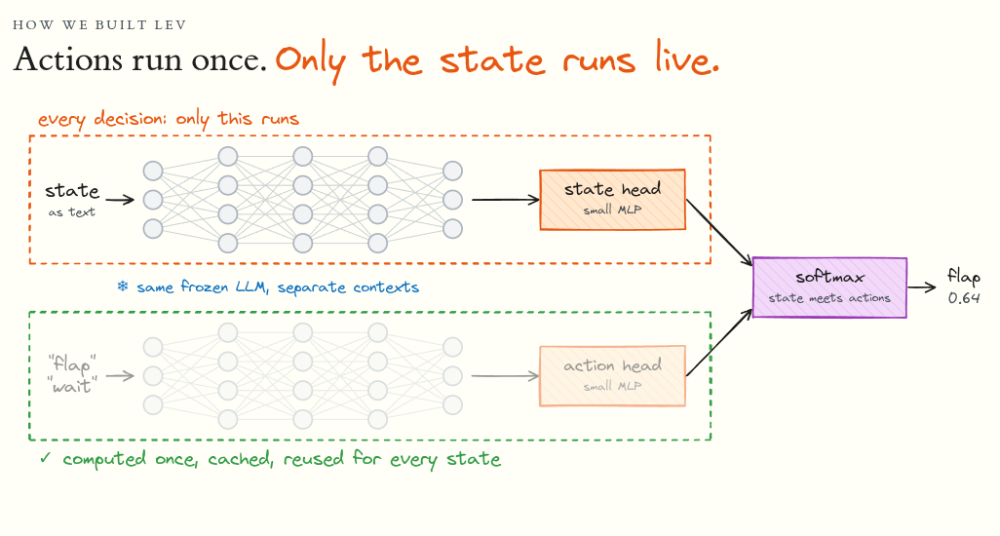
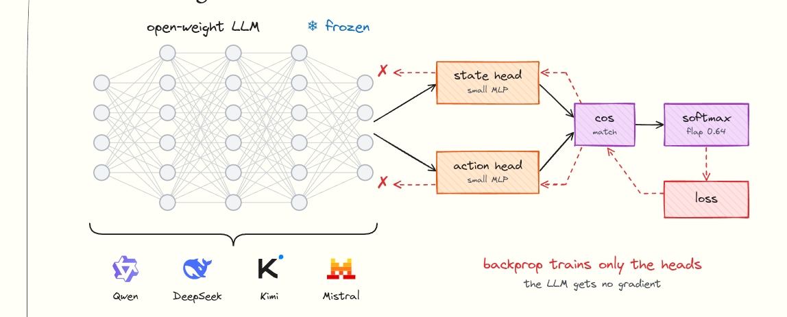

<p align="center">
  
</p>

<h3 align="center">Turn any open-weight model into a Jev-style System 1 model.</h3>

<p align="center">
  <a href="https://lev-self.vercel.app/"><b>▶ Live demo</b></a> ·
  <a href="https://huggingface.co/thomasliao/Lev"><b>🤗 Model on Hugging Face</b></a> ·
  <a href="docs/PLAN.md">Plan</a> ·
  <a href="docs/API.md">API</a>
</p>

# System 1 Playground

Small local System 1 models vs Jev vs a text LLM, racing in Flappy Bird and Chrome Dino.

| Flappy Bird | Chrome Dino |
| --- | --- |
|  |  |



## How it works

The game engine sends the game state to each model. Each model sends back an action.
Lev runs locally on an Asus GX10. Jev runs on TypeSafe. The site is Next.js on Vercel.



## How we built Lev

We keep a big open-weight LLM frozen. We swap its next-word layer for a small trained decision head.
The head only scores the allowed actions.



The actions are embedded once and cached. Each decision only runs the state through the model.



Backprop trains only the heads. The LLM gets no gradient.



## Code layout

```
packages/engine/   game engines (Flappy Bird, Dino), state text, questions, expert bot
apps/web/          Next.js site (Vercel)
scripts/gen-data/  expert bot → JSONL training data
server/            Python gateway on the GX10 (POST /v1/systemone)
```

## Run locally

```bash
pnpm install

# 1. Gateway (fake model only; add BASELINE=1 after `uv sync --extra baseline` for Qwen3-4B)
cd server && uv sync
SYSTEM1_API_KEY=dev-token ALLOWED_ORIGINS=http://localhost:3000 uv run uvicorn gateway.app:app --port 8000

# 2. Site (in another terminal)
cp apps/web/.env.example apps/web/.env.local   # add TYPESAFE_API_KEY for the Jev lane
pnpm dev                                        # http://localhost:3000/play
```

## Tests

```bash
pnpm test                       # engine (bot survives 20 pipes / 60 s of Dino)
cd server && uv run pytest      # gateway
```

## Training data

```bash
pnpm gen-data --game flappy --episodes 2000 --noise 0.1 --out data/flappy.jsonl
pnpm gen-data --game dino   --episodes 2000 --noise 0.1 --out data/dino.jsonl
```

One line per decision: `request` (exactly what models see), `label` (the expert's pick, preferring "do nothing"),
`safe_actions` (every action that survives the lookahead). Noise picks a random *safe* action 10% of the time.

## GX10 + Vercel

- GX10: run the gateway with `BASELINE=1`, a real `SYSTEM1_API_KEY`, and `ALLOWED_ORIGINS=https://<your-vercel-domain>`. Expose it with `tailscale funnel 8000`.
- Vercel: set `NEXT_PUBLIC_GATEWAY_URL` (the Funnel URL), `NEXT_PUBLIC_GATEWAY_TOKEN`, and `TYPESAFE_API_KEY`. Root directory: `apps/web`.
